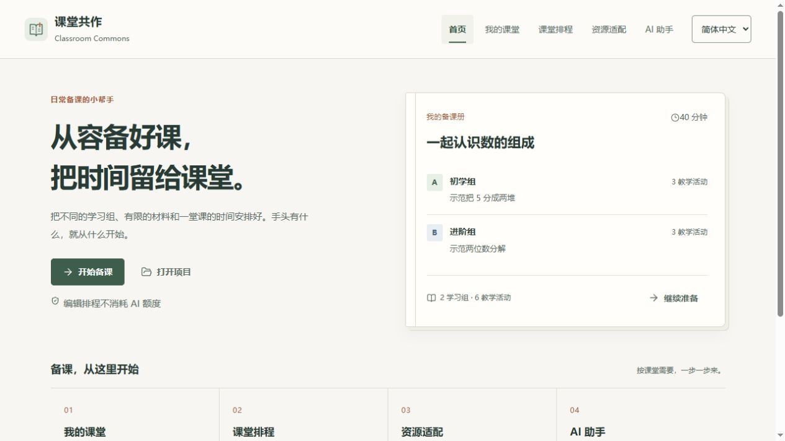

# Classroom Commons · 课堂共作

**课堂共作是为全球乡村与复式班教师设计的免费开源工具，支持离线备课、多组课堂排程、材料检查和实时上课模式。基础功能无需账号、付费订阅或 API。**

[English](README.md) · 0.6.1 · 免费开源工具包 · [MIT](LICENSE)

工作台、Skill、模板和全部功能均免费开源，不设付费版，原创代码采用 MIT 许可。本机备课不要求注册账号、填写 API 密钥、购买订阅或安装我们的客户端。编辑、资源检查、排程、保存与导出在本机运行。AI 起草是可选步骤，使用老师已有的助手；收费、额度和地区可用性由该平台决定。遇到付费提示就停止 AI 起草，已有课程仍可在工作台继续编辑、检查和导出。

0.6 版以备课册为视觉方向：暖白纸张、墨绿文字与陶土色小细节，首页用真实课程卡和四个编号模块进入备课。顶栏提供“首页”“我的课堂”“课堂排程”“资源适配”“AI 助手”五个入口。免费离线备课流程不依赖 AI。

## 为什么做、现在能做什么、以后怎么更新

师资紧张、复式班和材料不足，会增加部分乡村教师的备课负担，各地情况并不相同。我们帮助安排多组课堂的时间、检查材料条件、重复使用课程；软件无法补齐师资和经费，也不能替代教师判断。项目及官方更新坚持永久免费、MIT开源，不设付费版；自选外部AI服务可能收费。

0.6.1新增中英零共用材料口语课示例。更多案例、无障碍、低配设备与社区译文校对将按真实反馈推进，未完成的内容不写成已上线。

[全球乡村教师与项目使命](MISSION.md) · [维护与路线图](MAINTENANCE.md) · [更新日志](CHANGELOG.md)



## 老师怎么用

1. 解压工具包，打开 **老师先看这里.html**，点“打开备课工作台”。无需安装。
2. 在首页下方点“载入示例”，或用“打开项目”接着改备份、“新建课程”从头准备。点“开始备课”进入“我的课堂”，填写分组、时间、实际材料和教学活动。
3. 在“资源适配”查看缺口，替代活动合适才确认采用；在“课堂排程”点“生成课堂排程”。
4. 点“保存项目文件”留可继续编辑的备份；“离线教学包”供查看，“打印 / PDF”进入打印流程。下次打开原工作台，点“打开项目”选备份。

AI 可选：在“AI 助手”写需求→复制给已有的免费聊天助手→把完整回复粘回来审阅。不要求安装技能或编辑代码，回复读不出来可用“复制修正请求，再发给 AI”。

顶栏和首页四个编号模块都能进入各备课页面；随时点顶栏“首页”返回。课程卡可继续编辑；保存当前课程用首页下方的“保存项目文件”。

有经验的用户可自愿使用“AI 助手”页底部折叠的高级选项，直连自己填写的 API 服务。默认关闭，只有主动点 API 起草才发送请求，服务商可能收取接口费用。密钥仅留在当前页面内存，不写入课程备份；免费本机路径和复制粘贴路径都不依赖此功能。

下载时请保留工作台原文件。浏览器自动保存不能代替备份，重要课程请点“保存项目文件”。“离线教学包”是用于教学的只读教学单；再次编辑请打开原工作台并导入项目文件。

## 在支持 Skill 的软件中使用

安装技能是可选路径，仅适用于支持本格式的宿主。将 `classroom-commons` 文件夹通过该宿主的本地 Skill 入口导入，安装后对助手说：

> 打开课堂共作工作台，帮我准备一节多组教学课。

支持文件读写、运行脚本且已有 Python 的宿主，可以自动打开工作台、读取需求并送回草稿。老师点击“把需求交给 AI 助手”后，还需回到聊天说“按工作台里的需求备课”；网页不会自动唤醒宿主。没有运行环境时自动退回直接打开网页＋复制粘贴，不要求老师安装开发工具。

WorkBuddy 专用包位于“技能安装包”中的 `classroom-commons-workbuddy.zip`，包含其开放平台描述的中英文元数据。[简明步骤](guides/WorkBuddy怎么用.md)是按官方文档准备的待实测教程，不能当作已安装通过的证明。

| 软件 / 路径 | 当前核验范围 |
| --- | --- |
| Codex 等本地代理 | 本地桥接开发核验不代表各宿主安装或免费账号验收；此前当前会话的起草也不证明第三方免费额度可用 |
| WorkBuddy | 本机 5.8.3 窗口截图超时；尚未在真实免费账号安装、起草并返回课程 |
| 豆包普通聊天 | 用户明确要求跳过网页实测。[通用教程](guides/豆包怎么用.md)不要求安装 Skill，真实账号往返未验收 |
| 豆包工作 | 属于另一产品入口，不能将其技能能力和订阅权益直接视为普通豆包聊天的能力；当前未做原生安装验收 |

WorkBuddy 的[免费体验方案](https://www.codebuddy.cn/docs/workbuddy/Pricing)也有额度限制。各宿主的免费权益与访问条件需分别验收，不保证全球统一可用或无限免费 AI。详细事实见[宿主验收记录](research/host-acceptance.md)。

## 两项能力

- **MultiClass：复式班课堂排程。** 一位老师、多个学习组；检查师生时间重叠、共享材料容量、前置活动、阅读能力和老师设定的最长无指导间隔。活动延误后尝试重排，保留已开始的活动，不静默删任务。
- **ResourceFit：按真实条件改造活动。** 显示材料缺口、替代建议和目标保留理由；由老师确认适用性。程序通过约束检查，不代表课堂效果已经验证。

## 全球适配与边界

界面有中文、英文、西班牙语、阿拉伯语（RTL），支持 A4 / Letter；课程内容可用老师指定语言。不硬编码国家课程、学制或“年龄＝阅读能力”。目前示例正文为中英文，其他语言译文仍需母语教师审阅。“全球适配”是设计目标，尚未经过全球课堂验证。

首版支持一位老师、最多 6 组 / 24 活动、5–240 分钟。资源是“同时可用容量”，不处理耗材累计消耗。空白时间需老师安排常规活动。排程为有界搜索，找不到方案报告“本次未找到”，不冒充无解证明。无 OCR、自动教材对齐、学生账号或学习效果评定。

## 开发与打包

教师使用下载文件无需 Node 或 Python。以下命令仅供开发者：

```sh
npm ci
npm run build
npm test
npm start
python -m unittest discover -s test -p "test_*.py"
python scripts/release.py
```

界面使用 React、源码内维护的统一组件、Lucide 图标和 Radix 对话框。开发者使用 Node 22+，先运行 `npm ci` 安装锁定的依赖，再由 esbuild 构建。老师拿到的是内嵌代码、样式和后台排程程序的单文件 HTML，不需要开发环境或远程组件服务。打包和可选桥接使用 Python 3.9+ 标准库。

源码预览地址 `http://127.0.0.1:4173`。`npm start` 先构建再预览，`npm run preview` 仅预览现有发行文件。代码、样式与后台排程程序均由构建内嵌到单文件工作台。产物在 `releases/`：单文件工作台、Skill ZIP 和附使用指南的工具包。第三方授权全文内嵌于 HTML，发行 ZIP 同时附带 `THIRD_PARTY_NOTICES.txt`。

`Classroom-Commons-portable.zip` 面向老师，含一页网页教程、示例课程和教学单；`Classroom-Commons-source.zip` 是源码备份；`release-manifest.json` 记录版本、大小和 SHA256。[0.5 验收记录](research/release-0.5.0-verification.md)、[0.5 成品审查](research/product-review-0.5.0.md)和 [0.4 记录](research/release-0.4.0-verification.md)属于历史结果，不代表新版 0.6 界面已通过验收。

本地桥接只监听 `127.0.0.1`，仅访问选定目录的固定文件，使用随机会话令牌。无遥测或云端中转。主动发给宿主 AI 或自填 API 服务的课堂需求，适用相应服务商的数据政策。请用匿名学习组，不填学生姓名等身份信息。

这是可供教师试用的离线版本，尚未完成乡村教师试用、WorkBuddy / 豆包真实账户验收，以及 macOS / Linux 实测。研究范围及候选需求依据见 [GitHub 调研](research/github-codex-mods-landscape.md)。

## 许可说明

课堂共作原创代码，包括首页、界面 JavaScript 与 CSS，采用 [MIT 许可](LICENSE)。备课册界面针对教师备课独立设计。依赖保持各自许可，见 [THIRD_PARTY_NOTICES.txt](THIRD_PARTY_NOTICES.txt)；老师的课程内容不会因使用或导出而改变许可。
